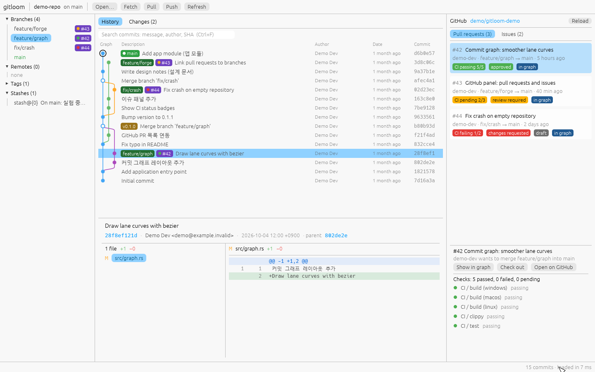
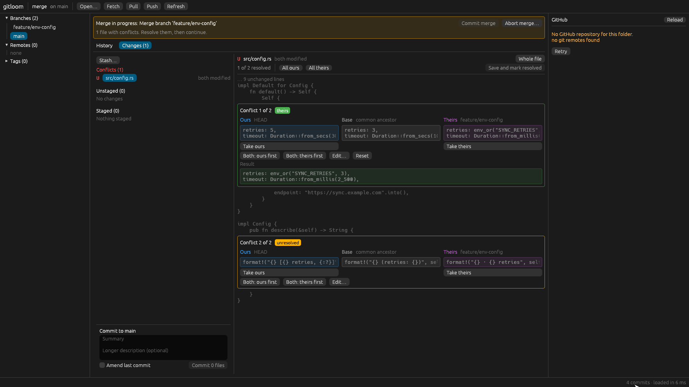
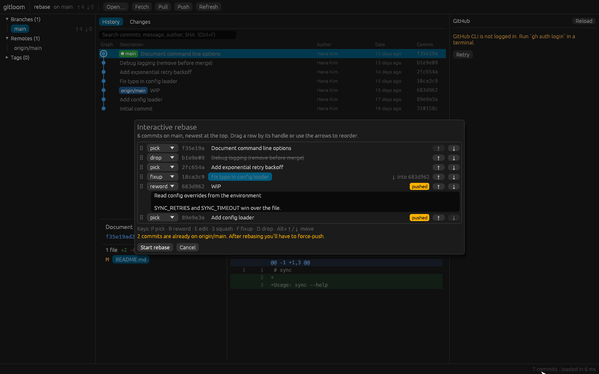
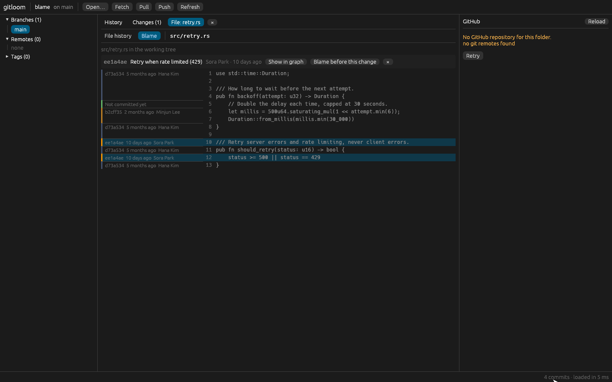
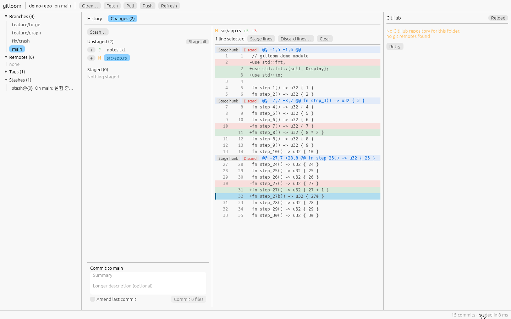

# gitloom

**커밋 그래프 · 변경사항 · Pull Request · 이슈 · CI를 한 화면에 엮는 가벼운 네이티브 Git GUI**

Rust와 [egui](https://github.com/emilk/egui)로 만든 크로스 플랫폼 데스크톱 앱입니다.
그래프가 좋은 Git 클라이언트는 PR·CI를 보여주지 못하고, PR을 보여주는 클라이언트는 그래프가 없는 문제를 풀려고 시작했습니다.
배경과 제품 비교는 [docs/research.md](docs/research.md)에 정리했습니다.

> 초기 프로토타입(v0.3)입니다. 중요한 저장소에서는 주의해서 사용하세요.



<sub>스크린샷은 데모 저장소와 예시 PR 데이터로 만든 화면입니다.</sub>

## 주요 기능

- **커밋 그래프**: 브랜치·태그·HEAD 라벨, 레인 색상, 머지 표시, 가상 스크롤(최근 커밋 20,000개), 키보드 탐색
- **커밋 검색**: 메시지·작성자·이메일·SHA로 찾기. 일치하는 커밋만 강조하고 Enter로 다음 결과로 이동
- **커밋 상세**: 메시지·작성자·부모 커밋, 변경 파일 목록, 줄 번호가 있는 diff
- **부분 스테이징**: 헝크마다 Stage / Unstage / Discard 버튼, 줄을 골라(클릭·Shift·Ctrl) 그 줄만 스테이징·언스테이징·되돌리기
- **변경사항**: 파일 단위 스테이징, 커밋과 amend(Ctrl+Enter), 파일 되돌리기·삭제
- **충돌 해결**: 진행 중인 merge·rebase·cherry-pick·revert를 배너로 보여주고 계속·건너뛰기·중단을 버튼 하나로. 충돌마다 ours·base·theirs를 나란히 비교해 한쪽이나 양쪽을 고르거나 직접 고치고, 파일 전체를 한쪽 버전으로 정하거나 삭제 충돌도 처리
- **인터랙티브 rebase**: 커밋을 끌어서(또는 ↑/↓, 단축키) 순서를 바꾸고 pick·reword·edit·squash·fixup·drop을 고른 뒤 실행. 이미 push한 커밋이면 경고하고, 커밋하지 않은 변경은 자동으로 stash
- **blame·파일 히스토리**: 줄마다 마지막으로 바꾼 커밋과 작성 시기(색으로 표시), 그 변경 이전 기준으로 다시 blame. 파일 히스토리는 이름 변경을 따라가고 커밋별 diff를 보여줌
- **stash**: 메시지와 untracked 파일 포함 여부를 정해 stash, 사이드바에서 내용 보기·apply·pop·drop
- **GitHub 연동**: 열린 PR(CI·리뷰 상태)과 이슈, PR별 체크 목록, 브라우저로 열기
- **그래프 ↔ PR 연결**: 브랜치 라벨 옆에 PR 번호와 CI 상태를 표시하고, PR에서 그래프로 이동하거나 `gh pr checkout`으로 바로 체크아웃
- **브랜치 작업**: 생성·전환·삭제(병합 여부 확인, 강제 삭제), merge·rebase·cherry-pick·revert, 원격 브랜치 체크아웃·삭제, fetch/pull/push와 force push(`--force-with-lease`)
- 되돌리기·삭제·drop·중단·force push처럼 되돌리기 어려운 작업은 항상 확인 창을 띄움
- 한글 등 CJK 커밋 메시지 표시(시스템 폰트 자동 사용), 저장소 폴더 드래그 앤 드롭

## 화면

**충돌 해결.** 충돌마다 ours·base·theirs를 비교하고 고른 결과를 바로 보여줍니다. base 칸은 `merge.conflictStyle`이 `diff3`/`zdiff3`일 때 나타납니다.



**인터랙티브 rebase.** 행을 끌어 순서를 바꾸고, reword는 그 자리에서 메시지를 고칩니다.



**blame.** 줄을 누르면 그 커밋의 줄이 모두 강조되고, 그래프로 이동하거나 이전 변경 기준으로 다시 blame할 수 있습니다.



**헝크·줄 단위 스테이징**



## 설계 원칙

| 원칙 | 내용 |
|---|---|
| 읽기는 빠르게 | 히스토리·diff·상태는 libgit2(`git2`)로 직접 읽고, 로딩은 모두 백그라운드 스레드에서 처리. blame과 파일 히스토리만은 `git` CLI 사용(`git blame`이 libgit2보다 훨씬 빠르고, `git log --follow`가 이름 변경을 따라감) |
| 쓰기는 진짜 `git`으로 | 스테이징·커밋·stash·merge·rebase 등은 `git` CLI를 실행해서 훅, 커밋 서명, 자격 증명, 설정이 터미널과 똑같이 동작. 부분 스테이징은 패치를 만들어 `git apply`로, 인터랙티브 rebase는 todo 목록만 바꿔 `git rebase -i`로 실행하므로 충돌·`--continue`도 git 그대로 |
| 인증은 재사용 | GitHub 데이터는 GitHub CLI(`gh`)로 가져와서 별도 로그인이나 토큰 저장이 없음 |
| 네이티브 단일 바이너리 | Electron 없이 Rust + egui로 Windows/macOS/Linux 지원 |

## 시작하기

### 필요 조건

- Rust 1.95 이상 ([rustup](https://rustup.rs))
- `git` (PATH에 있어야 함)
- (선택) [GitHub CLI](https://cli.github.com): `gh auth login`을 해 두면 PR·이슈 패널을 쓸 수 있음
- Windows는 Visual Studio C++ Build Tools, Linux는 eframe·rfd가 요구하는 시스템 라이브러리

### 실행

```bash
git clone https://github.com/kimyc3825/gitloom
cd gitloom
cargo run --release -- /path/to/your/repo
```

경로를 생략하면 현재 디렉터리가 저장소일 때 그 저장소를 열고, 아니면 시작 화면에서 폴더를 고를 수 있습니다.

### 조작

| 동작 | 방법 |
|---|---|
| 커밋 이동 | ↑ / ↓ / PgUp / PgDn / Home / End |
| 커밋 검색 | Ctrl+F, 다음/이전 결과는 Enter / Shift+Enter, 지우기는 Esc |
| 새로고침 | F5 (창에 포커스가 돌아오면 자동) |
| 커밋 | 메시지 입력 후 Ctrl+Enter |
| 파일 스테이징 | 파일 옆 `+` / `−` 버튼 또는 더블클릭, 우클릭하면 되돌리기·삭제·파일 히스토리·blame |
| 헝크 스테이징 | diff의 `@@` 줄에 있는 Stage hunk / Unstage hunk / Discard |
| 줄 스테이징 | diff에서 줄 클릭(Shift: 범위, Ctrl: 추가·제외) → Stage lines / Unstage lines / Discard lines |
| merge·rebase | 사이드바 브랜치나 그래프의 커밋 우클릭 → Merge … into … / Rebase … onto … |
| 충돌 해결 | Changes 탭의 Conflicts에서 파일 선택 → 충돌마다 Take ours / Take theirs / Both / Edit… → Save and mark resolved → 배너의 Continue(merge는 Commit merge) |
| 인터랙티브 rebase | 그래프에서 커밋 우클릭 → Rebase interactively from here… → 행을 끌거나 ↑/↓, 단축키 P R E S F D(pick, reword, edit, squash, fixup, drop), Alt+↑/↓로 이동 |
| blame·파일 히스토리 | 변경 파일이나 커밋 상세의 파일 우클릭 → File history / Blame. blame에서 줄 클릭 → Show in graph, Blame before this change |
| force push | 사이드바에서 현재 브랜치 우클릭 → Force push (with lease)… |
| 브랜치 | 사이드바에서 더블클릭으로 전환, 우클릭으로 생성·삭제 |
| 커밋 메뉴 | 그래프에서 우클릭 (SHA 복사, 브랜치 생성, 체크아웃, cherry-pick, revert) |
| stash | 변경사항 탭의 Stash…, 사이드바 stash 우클릭으로 apply·pop·drop |
| PR 브랜치로 이동 | PR 카드 더블클릭 또는 "Show in graph" |

## 구조

```
src/
├── main.rs             진입점, 창 설정
├── app/                앱 상태와 화면
│   ├── mod.rs          상태, 백그라운드 결과 처리, 툴바·상태바
│   ├── history.rs      커밋 그래프, 검색, 커밋 상세, 커밋 메뉴
│   ├── changes.rs      스테이징(파일·헝크·줄), 커밋
│   ├── merge.rs        진행 중인 작업 배너, 충돌 목록, 3-way 충돌 해결
│   ├── rebase.rs       인터랙티브 rebase 창(드래그 앤 드롭)
│   ├── file_view.rs    blame, 파일 히스토리
│   ├── sidebar.rs      브랜치·원격·태그·stash
│   ├── forge_panel.rs  PR·이슈·CI 패널
│   ├── dialogs.rs      브랜치 생성, 확인 창, stash 창
│   └── ui_tests.rs     egui_kittest로 실제 화면을 조작하는 UI 테스트
├── git/
│   ├── graph.rs        커밋 그래프 레인 배치 알고리즘
│   ├── repo.rs         libgit2 읽기: 히스토리, ref, stash, diff, 상태, 진행 중인 작업
│   ├── patch.rs        부분 스테이징용 패치 생성
│   ├── conflict.rs     충돌 마커 파싱과 해결 결과 만들기
│   ├── rebase.rs       인터랙티브 rebase 계획과 todo 목록
│   ├── blame.rs        blame, 파일 히스토리 (git CLI)
│   └── ops.rs          git CLI 쓰기: stage, commit, merge, rebase, 충돌 해결 …
├── forge/
│   ├── mod.rs          PR·이슈·체크 모델
│   └── github.rs       gh CLI 연동 (JSON 파싱)
├── ui/                 그래프 행, diff 뷰, 라벨(chip) 그리기
├── search.rs           커밋 검색
├── jobs.rs             백그라운드 작업 (스레드 + 채널)
├── fonts.rs            CJK 폰트 폴백
└── util.rs             시간 포맷, 프로세스 실행
```

## 개발

```bash
cargo test                   # 단위 테스트 + 실제 UI를 클릭해 보는 UI 테스트
cargo clippy --all-targets
cargo fmt
```

테스트는 임시 저장소를 만들어 진짜 `git`으로 확인합니다. merge·rebase·cherry-pick 충돌을 만들어 풀고 계속하거나 중단하는 흐름, 인터랙티브 rebase(순서 변경, reword, squash, fixup, drop, edit에서 멈췄다 계속), 로컬 bare 저장소를 상대로 한 force push까지 실제로 실행합니다.
UI 테스트는 [egui_kittest](https://crates.io/crates/egui_kittest)로 창 없이 앱을 띄워 버튼을 누르고 결과를 검사합니다. 대상은 헝크·줄 스테이징, 되돌리기 확인, 검색, stash, 브랜치 생성·삭제, 커밋, PR → 그래프 이동, 충돌 해결 뷰에서 merge 마무리, rebase 중단, 단축키와 드래그 앤 드롭으로 하는 인터랙티브 rebase, 파일 히스토리·blame입니다.

## 로드맵

PR 리뷰 코멘트, 이슈에서 브랜치 만들기 →
GitLab 지원, 명령 팔레트, reflog 기반 Undo, merge 커밋을 포함한 인터랙티브 rebase.
자세한 내용은 [docs/research.md의 로드맵](docs/research.md#6-범위와-로드맵)을 참고하세요.

## 라이선스

[MIT](LICENSE-MIT) 또는 [Apache-2.0](LICENSE-APACHE) 중 원하는 쪽을 선택해 사용할 수 있습니다.
